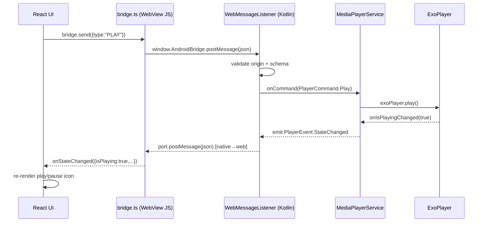
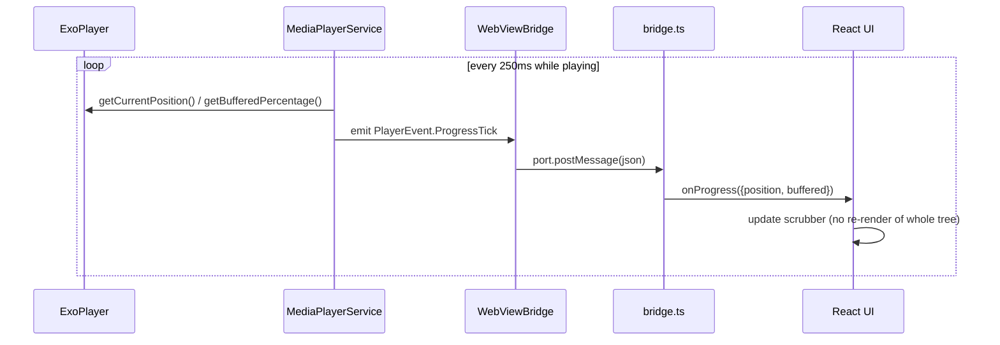
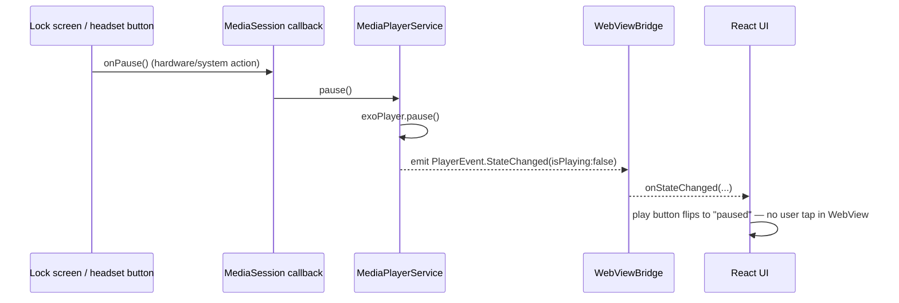
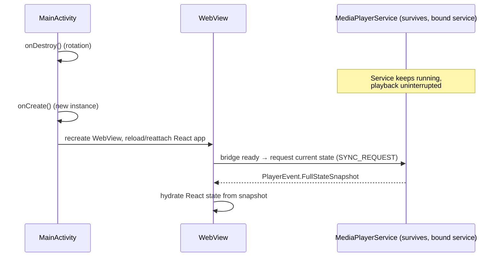

# Technical Design Document: WebView ↔ Native Media Player Bridge (POC)

**Status:** Proposed
**Date:** 2026-08-31
**Deciders:** Mobile lead, Web lead, POC engineer (you)
**Stack:** React + TypeScript (WebView content), Kotlin + Kotlin Multiplatform (Android native shell)
**Timeline:** 3–4 weeks

---

## 1. Context

We want a proof of concept demonstrating reliable, low-latency, bidirectional communication between a WebView (running a React/TS media player UI) and native Android code (Kotlin, structured with KMP so the bridge/domain logic could later extend to iOS). The chosen use case — a **media player** — is a good communication stress-test because it requires:

- **High-frequency native→web updates** (playback position, buffering state) — not just one-off request/response.
- **Web→native commands** (play, pause, seek, change track) that must be acknowledged reliably.
- **Native hardware/system integration** the web layer cannot do alone: `MediaSession`, background/foreground playback, lock-screen controls, audio focus handling, notifications.
- **Lifecycle correctness**: WebView reload, Activity recreation (rotation), process death, and app backgrounding must not desync the two sides.

### Goals (in scope for POC)
- Native Kotlin service (ExoPlayer/Media3) owns actual playback.
- React/TS WebView renders UI and controls, but never touches media APIs directly.
- Structured, typed, bidirectional bridge protocol (not raw string hacking).
- Continuous state sync (progress bar ticks) with acceptable jank (<100ms perceived lag).
- Basic lock-screen / notification controls prove the "native does what web can't" story.
- Security baseline: origin-restricted bridge, no arbitrary JS/native code execution surface.

### Non-goals (explicitly out of scope for a 3–4 week POC)
- iOS implementation (KMP structure allows it later, but no WKWebView bridge in this POC).
- DRM / offline downloads / adaptive bitrate tuning.
- Multi-window / Picture-in-Picture.
- Production-grade auth, analytics, crash reporting.
- Extensive automated test coverage (a thin smoke-test layer is enough for a POC).

---

## 2. Requirements

### Functional
| ID  | Requirement                                                                                                             |
| --- | ----------------------------------------------------------------------------------------------------------------------- |
| F1  | Web UI can command native player: `load`, `play`, `pause`, `seek(ms)`, `setVolume`, `next`, `prev`                      |
| F2  | Native pushes continuous playback state to web: `position`, `duration`, `isPlaying`, `bufferedPercent`, `playbackState` |
| F3  | Native pushes discrete events to web: `onTrackChanged`, `onError`, `onCompleted`                                        |
| F4  | Native shows a media notification / lock-screen control that stays in sync with web-initiated actions and vice versa    |
| F5  | WebView survives/recovers cleanly from Activity recreation (rotation) without losing playback                           |
| F6  | Bridge calls are typed and versioned end-to-end (TS types ⇄ Kotlin data classes)                                        |

### Non-functional
| ID  | Requirement                                                                                                                 |
| --- | --------------------------------------------------------------------------------------------------------------------------- |
| N1  | Perceived UI lag for progress updates ≤ 100ms                                                                               |
| N2  | Bridge messages must not block the WebView main thread noticeably (no jank on scroll/UI)                                    |
| N3  | Bridge must reject messages from any origin other than the bundled app origin                                               |
| N4  | Native player logic must not depend on Android-only APIs beyond what's isolated in `androidMain`, to preserve the KMP story |

### Constraints
- Solo/small-team POC, 3–4 weeks.
- Must demo convincingly in <2 minutes (this shapes what gets polished vs. stubbed).
- Team is comfortable with React/TS and Kotlin; KMP experience is light — keep the shared-module surface small and well-commented.

---

## 3. Architecture Decision: Bridge Transport

This is the central technical decision of the POC, so it gets ADR treatment.

### Option A: `addJavascriptInterface` + `evaluateJavascript`
**Pros:** Simple, well-documented, works on all WebView versions.
**Cons:** Historically insecure pre-API 17 (not a concern targeting modern minSdk); every exposed method is reflection-based and globally available to *any* page the WebView loads, so origin control must be enforced manually; native→web calls via `evaluateJavascript` are string-based JS injection (easy to get wrong with escaping); no built-in message ordering guarantees under rapid-fire calls.

### Option B: `WebMessageListener` / `postWebMessage` (AndroidX WebKit)
**Pros:** Origin-scoped by the platform (`addWebMessageListener(interfaceName, allowedOriginRules, listener)`), structured `MessagePort` model closer to the web `postMessage` API, no string-escaping JS injection needed, works naturally with a `window.postMessage`-shaped API on the web side that's idiomatic for React.
**Cons:** Requires `androidx.webkit` and a `WebViewFeature` capability check (fine — capability is available since WebView 88+, which is effectively all real-world devices in 2026); slightly more setup ceremony.

### Decision
**Use Option B (`WebMessageListener`) as the primary transport, with a typed envelope on both sides.** Origin-scoping is a real security requirement (N3), not a nice-to-have, and Option B gives it to us at the platform level instead of us hand-rolling origin checks inside a JS-reflected method. It also maps cleanly onto a `postMessage`-style TypeScript API, which is idiomatic for the React side and easy to type.

| Dimension                 | Option A                                | Option B                            |
| ------------------------- | --------------------------------------- | ----------------------------------- |
| Security (origin control) | Manual, easy to get wrong               | Platform-enforced                   |
| Fits React idioms         | Awkward (global `window.AndroidBridge`) | Natural (`window.postMessage`-like) |
| Structured payloads       | Manual JSON parse/stringify both ways   | Same, but cleaner message boundary  |
| Native→web push           | `evaluateJavascript` string injection   | `MessagePort.postMessage`           |
| Setup complexity          | Lower                                   | Slightly higher, one-time           |

### Consequences
- We add a thin **bridge protocol layer** (versioned JSON envelope, see §6) so the transport choice is swappable later without touching feature code.
- We still validate every incoming message's shape (don't trust origin scoping alone) — defense in depth.
- If future requirements need synchronous request/response semantics, we layer a `requestId` + `Promise` resolution scheme over the async port (see §6.3).

---

## 4. High-Level Architecture

```
┌─────────────────────────────────────────────────────────────────────┐
│ Android App Process                                                 │
│                                                                     │
│  ┌─────────────────────────┐        ┌─────────────────────────────┐ │
│  │ MainActivity            │        │ MediaPlayerService (fg svc) │ │
│  │ ┌─────────────────────┐ │        │  - Media3/ExoPlayer         │ │
│  │ │ AndroidWebView      │ │  bind  │  - MediaSession             │ │
│  │ │  ┌────────────────┐ │◄┼────────┼─►- Notification/lock screen │ │
│  │ │  │ WebViewBridge  │ │ │        │  - Audio focus handling     │ │
│  │ │  │ (WebMessage    │ │ │        └───────────┬─────────────────┘ │
│  │ │  │  Listener)     │ │ │                    │ Player events     │
│  │ │  └───────┬────────┘ │ │                    │                   │
│  │ │          │postMsg   │ │        ┌───────────▼─────────────────┐ │
│  │ │  ┌───────▼────────┐ │ │        │ shared (KMP commonMain)     │ │
│  │ │  │ React/TS App   │ │ │        │  - PlayerCommand/Event types│ │
│  │ │  │  - Player UI   │ │ │        │  - BridgeMessage envelope   │ │
│  │ │  │  - bridge.ts   │ │ │        │  - Serialization (kotlinx)  │ │
│  │ │  │    (client SDK)│ │ │        └─────────────────────────────┘ │
│  │ │  └────────────────┘ │ │                                        │
│  │ └─────────────────────┘ │                                        │
│  └─────────────────────────┘                                        │
└─────────────────────────────────────────────────────────────────────┘
```

### Component responsibilities

- **React/TS App (WebView content)** — Pure UI + state rendering. Never touches media APIs. Sends typed *commands*, receives typed *state/events* via `bridge.ts`, a small client SDK wrapping `postMessage`.
- **WebViewBridge (Kotlin, `androidMain`)** — Owns the `WebMessageListener`, serializes/deserializes `BridgeMessage` envelopes, forwards commands to `MediaPlayerService`, forwards player events back to the WebView.
- **MediaPlayerService** — Foreground service wrapping Media3/ExoPlayer, owns `MediaSession` (lock screen, notification, headset buttons), is the *single source of truth* for playback state.
- **KMP `commonMain` shared module** — Defines the bridge protocol types (`PlayerCommand`, `PlayerEvent`, `BridgeMessage<T>`) and `kotlinx.serialization` models, so the contract is centralized, versioned, and (for a future iOS target) reusable. Mirrored by hand-written TS types today (see §6.4 on codegen vs. manual sync trade-off).

---

## 5. Sequence Diagrams

### 5.1 Web-initiated command (e.g., user taps Play)



### 5.2 Native-driven continuous progress sync


*Note:* 250ms tick chosen to balance smoothness vs. bridge/message overhead — tune during POC; UI can locally interpolate between ticks with `requestAnimationFrame` for sub-100ms perceived smoothness (N1) without needing a faster native tick rate.

### 5.3 Lock-screen action → web sync (proves native-owns-truth)



### 5.4 Activity recreation (rotation) — state recovery



---

## 6. Bridge Protocol (Key Contract)

This is the **most important artifact** in the POC — get this right and both sides can be built in parallel.

### 6.1 Envelope shape (both directions)

```ts
// TypeScript (web side)
interface BridgeMessage<T = unknown> {
  v: 1;                    // protocol version — bump on breaking changes
  id: string;               // uuid, for correlating request/response
  type: string;              // discriminant, e.g. "PLAY" | "PROGRESS_TICK"
  payload: T;
  ts: number;                // sender timestamp, ms epoch
}
```

```kotlin
// Kotlin (commonMain, kotlinx.serialization)
@Serializable
data class BridgeMessage<T>(
    val v: Int = 1,
    val id: String,
    val type: String,
    val payload: T,
    val ts: Long
)
```

### 6.2 Command / Event catalog

| Direction  | Type                  | Payload                                        | Notes                                       |
| ---------- | --------------------- | ---------------------------------------------- | ------------------------------------------- |
| Web→Native | `LOAD`                | `{ mediaId: string, url: string }`             |                                             |
| Web→Native | `PLAY` / `PAUSE`      | `{}`                                           |                                             |
| Web→Native | `SEEK`                | `{ positionMs: number }`                       |                                             |
| Web→Native | `SET_VOLUME`          | `{ volume: number 0..1 }`                      |                                             |
| Web→Native | `SYNC_REQUEST`        | `{}`                                           | Ask for full state (used on reattach, §5.4) |
| Native→Web | `STATE_CHANGED`       | `{ isPlaying, playbackState, currentMediaId }` | Discrete transitions                        |
| Native→Web | `PROGRESS_TICK`       | `{ positionMs, durationMs, bufferedPct }`      | High-frequency                              |
| Native→Web | `TRACK_CHANGED`       | `{ mediaId, title, artist, artworkUrl }`       |                                             |
| Native→Web | `ERROR`               | `{ code, message, recoverable }`               |                                             |
| Native→Web | `FULL_STATE_SNAPSHOT` | union of the above                             | Response to `SYNC_REQUEST`                  |

### 6.3 Request/response over an async channel
`WebMessagePort` is fire-and-forget by design. For the rare case where web needs a true request/response (e.g., confirm `LOAD` succeeded before showing UI), layer a `Promise` on top: `SDK` keeps a `Map<id, resolver>`, resolves on any incoming message whose `id` matches. This is a ~20-line utility (`bridge.ts`), not a new transport.

### 6.4 Keeping TS and Kotlin types in sync
For a 3–4 week POC, **hand-mirror the types** on both sides rather than introducing a codegen pipeline (e.g., generating TS from `kotlinx.serialization` schemas) — the protocol surface above is small (~9 message types), and codegen tooling setup would eat a meaningful chunk of the timeline for marginal benefit at this scale. Flag this explicitly as a **first thing to revisit** if the POC graduates toward production (see §9).

---

## 7. Security & Key Considerations

| Concern                                                            | Mitigation                                                                                                                                                                                                         |
| ------------------------------------------------------------------ | ------------------------------------------------------------------------------------------------------------------------------------------------------------------------------------------------------------------ |
| Arbitrary origin can talk to the bridge                            | `addWebMessageListener` with `allowedOriginRules` locked to the app's bundled asset origin (`https://appassets.androidplatform.net` if using `WebViewAssetLoader`, or the specific `file://`/custom scheme in use) |
| Malformed/malicious payloads crash native                          | Every incoming message schema-validated (`kotlinx.serialization` will throw on mismatch — catch and drop, log, never crash the service)                                                                            |
| WebView loading untrusted remote content                           | For the POC, bundle the React build as local assets via `WebViewAssetLoader` rather than loading a remote URL — removes a whole class of "who can post to this bridge" concerns                                    |
| Foreground service / notification permissions                      | Request `POST_NOTIFICATIONS` (API 33+) and foreground service media type declaration up front; handle denial gracefully in the demo script                                                                         |
| Message flood from progress ticks impacting WebView responsiveness | Keep tick payload minimal, throttle to 250ms server-side, let UI interpolate (§5.2) rather than raising native tick rate                                                                                           |
| Protocol drift between TS/Kotlin                                   | `v` field in envelope; reject unknown `v` gracefully with a visible (but non-fatal) error in the demo, rather than silent corruption                                                                               |

---

## 8. Suggested Project Structure

```
media-poc/
├── shared/                      # KMP module
│   └── src/commonMain/kotlin/bridge/
│       ├── BridgeMessage.kt
│       ├── PlayerCommand.kt
│       └── PlayerEvent.kt
├── androidApp/
│   └── src/main/kotlin/
│       ├── MainActivity.kt
│       ├── bridge/WebViewBridge.kt
│       └── player/MediaPlayerService.kt
└── web/                          # React + TS
    └── src/
        ├── bridge/bridge.ts       # client SDK (postMessage wrapper, Promise layer)
        ├── bridge/types.ts        # mirrors shared/ Kotlin types by hand
        └── player/PlayerScreen.tsx
```

---

## 9. Timeline (3–4 weeks)

| Week | Focus                                                                                                                                                   | Exit criteria                                                                                                   |
| ---- | ------------------------------------------------------------------------------------------------------------------------------------------------------- | --------------------------------------------------------------------------------------------------------------- |
| 1    | Bridge skeleton: `WebViewAssetLoader` + `WebMessageListener` wired to a static React page; round-trip a `PING`/`PONG` message                           | Console log proves bidirectional message flow, origin restriction verified by testing a mismatched origin fails |
| 2    | `MediaPlayerService` with Media3/ExoPlayer + `MediaSession`; wire `LOAD/PLAY/PAUSE/SEEK` commands and `STATE_CHANGED`/`PROGRESS_TICK` events end-to-end | Can play/pause/seek a real audio file from the React UI, progress bar updates live                              |
| 3    | Lock-screen/notification controls; Activity recreation recovery (`SYNC_REQUEST`/`FULL_STATE_SNAPSHOT`); error handling path                             | Rotating the device or pausing from the lock screen keeps both sides in sync                                    |
| 4    | Polish UI, harden schema validation, write demo script, dry-run the 2-minute walkthrough, document known gaps                                           | Demo runs reliably end-to-end twice in a row without a rebuild                                                  |

---

## 10. Open Questions / What We'd Revisit

- **Codegen for the protocol types** (§6.4) — worth it once the message catalog grows past what's comfortable to hand-mirror.
- **iOS target** — the `commonMain` module is structured to support it, but no WKWebView bridge work is in scope here.
- **Testing strategy** — this POC intentionally under-invests in automated tests; a real follow-up would want contract tests on `BridgeMessage` (de)serialization on both sides at minimum.
- **Tick rate tuning** — 250ms is a starting guess; validate against N1 (≤100ms perceived lag) with real interpolation and adjust.